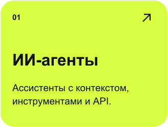
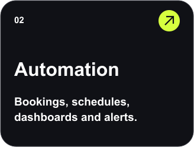
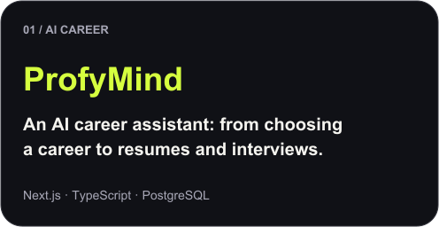
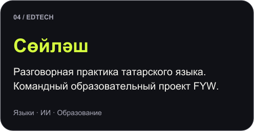

  

 

### About me

I'm Danil, the **founder and team lead of FYW — Find Your Way**. I work on product, interfaces and automation: understanding business needs, designing user journeys and building working applications with my team.

My current focus is **AI agents, API integrations and systems that reduce manual work**. I connect AI with real business processes, from finding customers and booking services to building personal assistants.

**Tech stack:** TypeScript / JavaScript · React / Next.js · Node.js · PostgreSQL / Prisma · Git / Docker.

Some projects are developed in private repositories. Public code: <a href="https://github.com/danisimo299-star/ai-career-agent">ProfyMind</a> · <a href="https://github.com/danisimo299-star/deals-ai-assistant">Business AI Assistant</a>.
