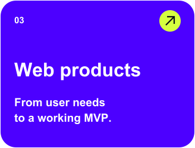
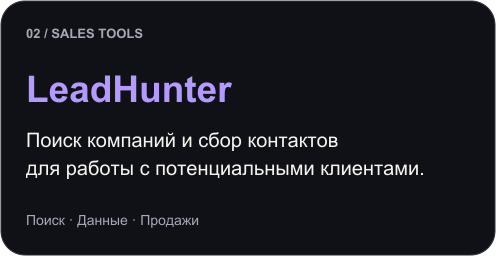
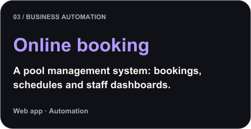

  

 

### Обо мне

Я Данил, сооснователь **FYW — Find Your Way**. Занимаюсь продуктом, интерфейсами и автоматизацией: разбираюсь в задаче бизнеса, продумываю сценарии и вместе с командой превращаю их в работающие приложения.

Сейчас мой фокус — **ИИ-агенты, интеграции API и системы, которые сокращают ручную работу**. Мне интересно соединять ИИ с реальными процессами: поиском клиентов, записью на услуги и персональными помощниками.

**В проектах:** TypeScript / JavaScript · React / Next.js · Node.js · PostgreSQL / Prisma · Git / Docker.

Часть проектов развивается в закрытых репозиториях. Доступный код: <a href="https://github.com/danisimo299-star/ai-career-agent">AI Career Agent</a> · <a href="https://github.com/danisimo299-star/deals-ai-assistant">Business AI Assistant</a>.
